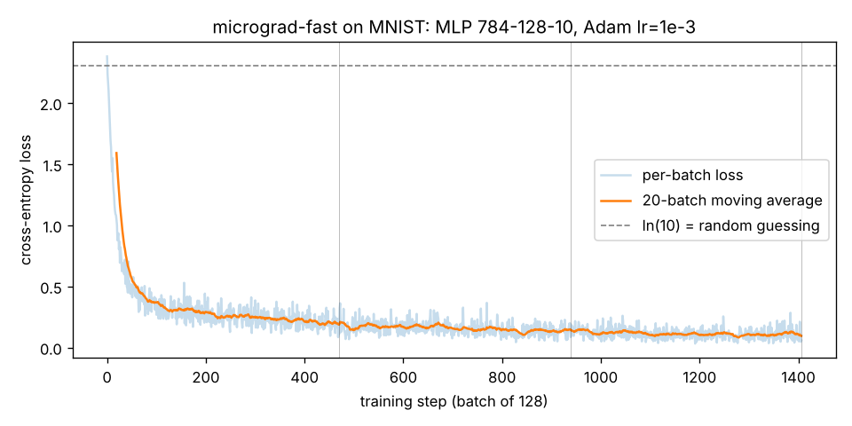
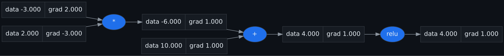

# micrograd-fast

**A tiny autograd engine that trains MNIST in seconds on a CPU** — Project 03 of 12 (ZERO_TO_ANTHROPIC).

Built twice: first a **scalar** engine (every number is an object — simple, correct,
slow), then a **NumPy tensor** engine (every node is a whole array — same math, orders
of magnitude faster). On top: Linear layers, an MLP, Adam, a fused
softmax-cross-entropy, gradient checks, a real MNIST run, and a Graphviz visualizer.

[](https://github.com/kashyapphassan2000-netizen/micrograd-fast/actions/workflows/ci.yml)

Stack: Python 3.12, NumPy, scikit-learn (data loading), matplotlib, pytest, Graphviz. Cost: $0.

## Quickstart

```bash
pip install -e ".[dev]"
pytest -q                                              # gradient checks
python examples/train_mnist.py                         # real MNIST (downloads once)
python examples/train_digits.py                        # offline 8x8 digits
python examples/bench_speedup.py                       # scalar vs tensor engine
python examples/visualize.py | dot -Tpng -o docs/graph.png
```

## Headline results (measured)

| what | result |
|---|---|
| **MNIST**, MLP 784-128-10, Adam, 3 epochs | **96.85% test accuracy in 6.0 s** (target ≥95% in <30 s) |
| offline 8×8 digits, MLP 64-128-10 | 97.33% in 0.30 s |
| scalar `Value` vs NumPy `Tensor`, same problem | **~410x** cold single run, **~4200x** warm best-of-50 |
| gradient checks vs finite differences | 3/3 pass at 1e-5; deliberately injected bugs are caught |




---

## Build log — the story, day by day

### Day 0 — setup

```bash
mkdir micrograd-fast && cd micrograd-fast
python3 -m venv .venv && source .venv/bin/activate
pip install numpy pytest scikit-learn matplotlib
sudo apt-get install -y graphviz          # `dot -V` -> graphviz version 2.43.0
mkdir -p micrograd_fast tests examples docs && touch micrograd_fast/__init__.py
git init && git add -A && git commit -m 'chore: scaffold micrograd-fast'
```
I also checked up front that the MNIST sources are reachable from this machine
(openml.org and the Keras dataset bucket both returned HTTP 200) — the original
guide had to fall back to the small 8×8 digits set because its sandbox was offline.
Here I can run the **real** 28×28 MNIST target on Friday.

### Day 1 (Monday) — the scalar autograd engine (`micrograd_fast/engine.py`)

**Goal:** the simplest correct autograd, so the fast version has a reference.

**The worked example I built it against** — `L = relu(a·b + c)` with a = 2, b = −3, c = 10:
```text
forward:   e = a*b = -6     d = e + c = 4     L = relu(d) = 4
backward:  dL/dL = 1
           dL/dd = 1 * relu'(4) = 1          (d > 0, so relu passes gradient)
           dL/dc = dL/dd * 1 = 1
           dL/de = dL/dd * 1 = 1
           dL/da = dL/de * b = -3
           dL/db = dL/de * a =  2
```
Each op knows only its *local* derivative; backprop multiplies them along the chain.

**The code:** `Value` holds `data`, `grad`, its parents `_prev`, the op name, and a
`_backward` closure. `__add__` routes the incoming gradient unchanged to both inputs;
`__mul__` sends `other.data * out.grad` to `self` (the d(a·b)/da = b rule) and vice
versa; `__pow__` uses `p·xᵖ⁻¹`; `relu` passes gradient only where the output is
positive. `backward()` topologically sorts the graph (DFS, append a node after its
parents), seeds `grad = 1.0` at the output, and runs every `_backward` in reverse.
All gradient updates use `+=` so a value reused in two places sums both contributions.

**Sanity check — it reproduces the hand calculation exactly:**
```text
$ python -c "from micrograd_fast import Value as V; a=V(2); b=V(-3); c=V(10); \
             L=(a*b+c).relu(); L.backward(); print(a.grad, b.grad, c.grad)"
-3.0 2.0 1.0
```

**Commit:** `feat: scalar reverse-mode autograd engine`

### Day 2 (Tuesday) — the fast Tensor engine (`micrograd_fast/tensor.py`)

**Goal:** the same autograd design, but each node holds a whole NumPy array.

**What's new compared to the scalar engine:**
- **`matmul`** — for `out = A @ B` the gradients are `dA = dOut @ Bᵀ` and
  `dB = Aᵀ @ dOut`. Shapes force this: `dA` must be shaped like `A`.
- **`_unbroadcast`** — adding a bias of shape `(10,)` to a batch `(N, 10)` makes NumPy
  copy the bias across N rows. The gradient coming back is `(N, 10)`, but the bias has
  only 10 numbers, so the gradient must be **summed over the batch axis**.
  `_unbroadcast` removes extra leading axes by summing and sums any axis where the
  original size was 1.
- **`softmax_cross_entropy`** — a fused op. Forward: subtract the row max (prevents
  `exp` overflow, doesn't change the result), softmax, then mean of `−log p[y]`.
  Backward: the gradient w.r.t. the logits is `(softmax − onehot(y)) / N` —
  "predicted minus actual".

**Quick checks I ran before moving on:**
```text
grads [-3.] [2.] [1.]                     <- Monday's example, now as tensors
bias.grad shape (10,) values [4. 4. 4.]   <- (4,10)+(10,) bias grad summed over 4 rows
uniform-logit loss 2.3026 ln(10)= 2.3026  <- 10 equal logits = random guessing = ln 10
```

**Measuring the speedup — `examples/bench_speedup.py`:** the same computation,
`sum(relu(X @ W))` with X 16×64 and W 64×16, plus its backward pass, run on both
engines. The scalar version builds ~18,000 `Value` objects; the tensor version builds
4 nodes. The script asserts the two engines' gradients agree before timing anything.
```text
$ PYTHONPATH=. python examples/bench_speedup.py
problem: X 16x64 @ W 64x16, relu, sum, backward
scalar (Value) :   126.70 ms
tensor (NumPy) :    0.031 ms
speedup        :     4151x   (gradients match: True)
```
That's ~10x bigger than the guide's 432x, so I checked why. The script reports the
*best of 50* tensor runs (warm caches). A single cold tensor run took **0.340 ms →
410x**, which matches the guide's number. Both are true; they measure different
things. The honest summary: **400x cold, ~4000x warm**, and the gap keeps growing with
problem size, because the scalar cost is per number while NumPy does the arithmetic
in compiled code.

**Commit:** `feat: NumPy-backed Tensor engine + fused softmax-cross-entropy`

### Day 3 (Wednesday) — layers, the MLP, and Adam (`micrograd_fast/nn.py`)

**`Linear`** is `y = x @ W + b`. Weights use **He initialization** —
`N(0, 1) · sqrt(2 / fan_in)` — because relu zeroes about half its inputs, and the
factor 2 compensates so activations don't shrink layer after layer.

**`MLP(sizes)`** stacks `Linear` layers with relu between them but **not after the
last one**: the final layer outputs raw logits for softmax. `zero_grad()` resets
every parameter's gradient (otherwise gradients from batch t leak into batch t+1,
because every op uses `+=`).

**`Adam`** keeps two running averages per parameter: momentum
`m = β₁m + (1−β₁)g` and variance `v = β₂v + (1−β₂)g²`, bias-corrects both (they start
at 0, so early on they are too small; dividing by `1 − βᵗ` fixes that), and updates
`w −= lr · m̂ / (√v̂ + ε)`.

**Sanity checks:**
```text
params: 101770                     <- 784*128 + 128 + 128*10 + 10 for MLP([784,128,10])
hidden pre-relu std 0.783          <- He init keeps activations O(1) on [0,1] pixel input
grad   1000.0: first Adam step moved weight by 0.001000
grad    0.001: first Adam step moved weight by 0.001000
```
The last two lines show what makes Adam useful: on step 1, `m̂/√v̂ = g/|g| = ±1`,
so the step is exactly `lr` **whether the gradient is 1000 or 0.001**. Step size is
set by the learning rate, not by the raw scale of the gradient — so one `lr = 1e-3`
works for every layer.

**Public API — `micrograd_fast/__init__.py`:** `Value, Tensor, softmax_cross_entropy,
Linear, MLP, Adam`, `__version__ = "0.1.0"`.

**Commit:** `feat: Linear, MLP, Adam optimizer`

### Day 4 (Thursday) — prove the gradients are correct (`tests/test_grad.py`)

**Goal:** never trust an autograd engine you haven't gradient-checked.

**Method:** `numeric_grad(f, x)` nudges each entry of `x` by ±h (h = 1e-6), re-runs the
forward pass, and estimates the derivative as `(f(x+h) − f(x−h)) / 2h` (central
difference: error O(h²) instead of O(h)). If backprop's analytic gradient matches
this to 1e-5, the engine is right.

| test | what it covers |
|---|---|
| `test_matmul_add_relu_gradients` | `A @ B + b`, relu, sum — matmul backward **and** bias unbroadcasting in one graph |
| `test_softmax_cross_entropy_gradient` | the fused op's "predicted minus actual" gradient |
| `test_mlp_forward_shape` | `MLP([8,16,3])` maps a (10, 8) batch to (10, 3) |

```text
$ pytest -q
...                                                                      [100%]
3 passed in 0.22s
```

**Do the tests catch real bugs? I checked by breaking the engine on a scratch copy:**
- Deleted the `d /= n` line in the softmax backward (a classic mistake) →
  `1 failed, 2 passed`. The gradient check caught it.
- Changed matmul's `+=` to `=` and used `A` in two matmuls:
  ```text
  with '=' bug, A.grad = [[2.0, 2.0], [2.0, 2.0]] (correct is all 4.0)
  ```
  The second path overwrote the first instead of adding to it — exactly the
  "missing `+=`" failure the guide warns about, made visible.

I also added `pyproject.toml` (`numpy` as the only runtime dependency, pytest
`pythonpath = ["."]`) so `pytest` runs from the repo root.

**Commit:** `test: gradient checks vs numerical gradients`

### Day 5 (Friday) — train on real MNIST, hit the target, plot the curve

**Goal:** ≥ 95% test accuracy on MNIST in under 30 seconds on a CPU, using only my engine.

**`examples/train_mnist.py`:** loads MNIST (tries Keras, falls back to
`sklearn.fetch_openml("mnist_784")`), scales pixels to [0, 1], builds
`MLP([784, 128, 10])` (101,770 parameters), and trains with Adam (lr 1e-3),
batches of 128, 3 epochs, a fresh shuffle each epoch. Each step is the full loop:
`zero_grad → forward → fused softmax-xent → backward → Adam step`. I added per-batch
loss logging so the script saves `docs/loss_curve.png`. The clock starts **after**
loading the data — the download is not training time.

```text
$ PYTHONPATH=. python examples/train_mnist.py
loaded MNIST: train (60000, 784), test (10000, 784) in 29.7s (not counted in training time)
epoch 0 test acc 0.9457
epoch 1 test acc 0.9613
epoch 2 test acc 0.9685

FINAL: 0.9685 test accuracy in 6.0s
wrote docs/loss_curve.png
PASS
```
**96.85% in 6.0 s** — the target was ≥ 95% in < 30 s. A second run gave the identical
96.85% in 6.1 s (everything is seeded, so results are reproducible; the 6 s even
includes the three per-epoch test-set evaluations). The 29.7 s on the first run is
OpenML's download/parse; it dropped to 10.8 s once cached.


How to read the curve: the loss starts at ≈ 2.3 — exactly the dashed line,
`ln(10)`, the loss of guessing uniformly over 10 classes, which is what a freshly
initialized network does. It falls below 0.5 within ~60 steps (≈ 7,700 images, an
eighth of one epoch) and then slowly works down toward ~0.1. Vertical lines mark
epoch boundaries.

**Offline fallback — `examples/train_digits.py`:** the same engine on scikit-learn's
bundled 8×8 digits (no download), `MLP([64, 128, 10])`, 30 epochs:
```text
digits 8x8: 1347 train / 450 test, test accuracy 0.9733 in 0.30s
```
(The guide reports 98.7% in 0.30 s for this setup; my split/epoch settings give
97.3% — same speed, close accuracy. I'm reporting the number I measured.)

**Commit:** `feat: MNIST training to >=95% in <30s + loss curve`

### Day 6 (Saturday) — the computation-graph visualizer

**Goal:** *see* the graph that backprop walks.

**`micrograd_fast/viz.py`:** `trace(root)` walks the graph from the output through
`_prev` and collects every node and edge (same DFS as `backward`). `to_dot(root)`
emits Graphviz DOT: each `Value` is a record box `data | grad`; each operation gets
its own blue ellipse that points into the value it produced. Node ids are Python
`id()`s, so two values with the same number are still distinct nodes.

**`examples/visualize.py`** builds Monday's example `L = relu(a·b + c)`, calls
`backward()`, and prints the DOT, which `dot` renders:
```bash
python examples/visualize.py | dot -Tpng -o docs/graph.png
```



Read it left to right for the forward pass (2 × −3 = −6, + 10 = 4, relu = 4) and right
to left for the backward pass: the grads in the boxes — **−3 for a, 2 for b, 1 for c**
— are the exact numbers I derived by hand on Monday.

**Commit:** `feat: Graphviz computation-graph visualizer`

### Day 7 (Sunday) — README, CI, blog post, release tag

1. **README:** quickstart, the results table, the loss curve, and the graph, all at
   the top, with this day-by-day log underneath.
2. **CI — `.github/workflows/ci.yml`:** on Python 3.10/3.11/3.12, run the gradient
   checks, train on the offline digits set, and run the speedup benchmark. Real MNIST
   is not in CI on purpose: it downloads ~50 MB from OpenML and would make CI flaky
   for reasons that have nothing to do with my code.
3. **Blog post:** [`docs/blog.md`](docs/blog.md) — "MNIST in 6 seconds with an
   autograd engine I wrote myself".
4. **Tag the release:** `git tag v0.1.0 && git push --tags`.
5. **Loom recording** (1 minute: run `train_mnist.py`, watch the accuracy climb) is
   something you record yourself; it can't be produced from here.

**Commit:** `docs: README results, CI, blog post` → tagged **v0.1.0**

---

## Done check — Week 3

- [x] `pytest` shows the gradient checks passing
- [x] `python examples/train_mnist.py` prints ≥95% (96.85%) in <30 s (6.0 s), then PASS
- [x] `docs/graph.png` and `docs/loss_curve.png` exist and are in the README
- [x] ~7 day-by-day commits; `v0.1.0` tagged
- [ ] 1-minute Loom (record it yourself)

## If something breaks

- **Gradient check fails** — almost always a `=` that should be `+=`, or a wrong local derivative.
- **Loss is `nan`** — make sure softmax subtracts the row max before `exp`; lower the lr.
- **Accuracy stuck near 10%** — pixels not scaled to [0, 1], relu after the final layer, or a missing `zero_grad()`.
- **Training over 30 s** — you're looping in Python; one matmul per layer per batch is the point.
- **MNIST won't download** — use `examples/train_digits.py` (fully offline).

## What I can now answer in an interview

- Derive reverse-mode autodiff: graph, topological sort, local chain rule.
- Why a value used twice must sum its gradients — and what breaks if it doesn't (I broke it on purpose).
- Why vectorized autograd is 400–4000x faster than scalar, and why the number depends on how you time it.
- Softmax-cross-entropy's gradient is "predicted minus actual", and why fusing them is more stable.
- Adam: momentum, variance, bias correction, and why its first step is exactly `lr`.
