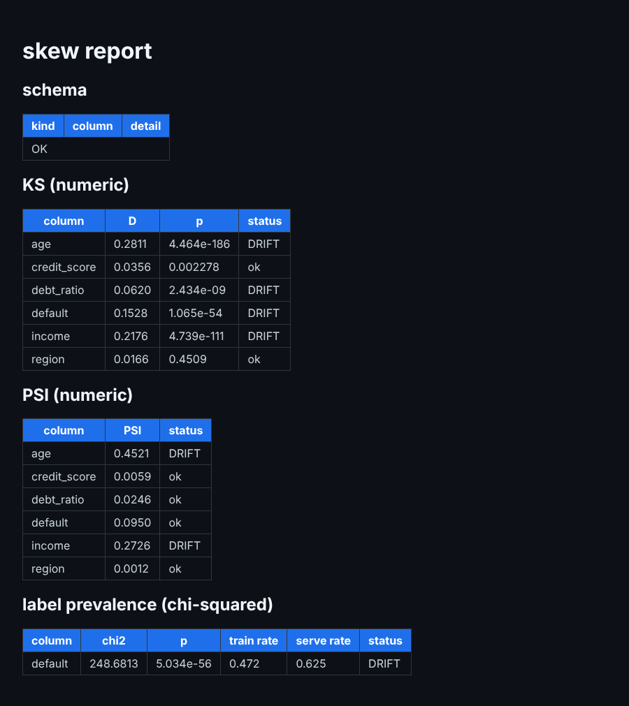
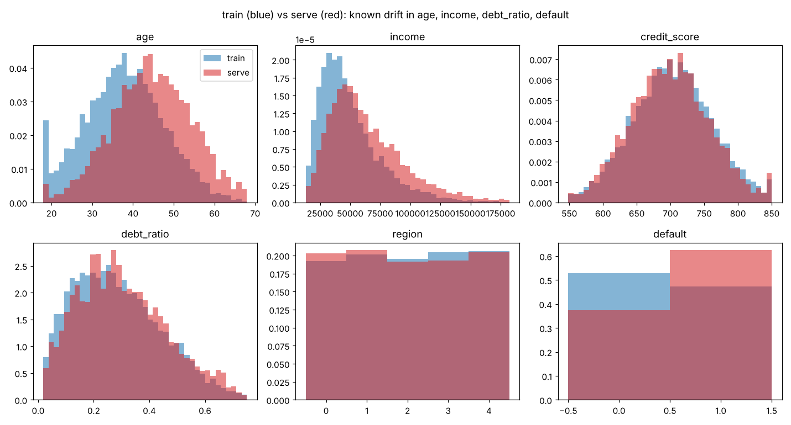

# skew-detector

**A CLI that catches the silent killer of production ML: data drift** — Project 05 of 12 (ZERO_TO_ANTHROPIC).

Point it at a training CSV and a serving CSV. It diffs the schema, runs two
distribution-drift tests per numeric column (Kolmogorov-Smirnov with Bonferroni
correction, and the Population Stability Index), tests label-prevalence shift
with chi-squared, renders a terminal report, writes HTML/JSON, and exits non-zero
on drift so it can gate CI.

[](https://github.com/kashyapphassan2000-netizen/skew-detector/actions/workflows/ci.yml)

Stack: Python 3.12, pandas, SciPy, NumPy, Click, Rich, pytest, matplotlib. Cost: $0.

## Quickstart

```bash
pip install -e ".[dev]"
pytest -q                                                    # 6 tests
python examples/make_data.py                                 # known-drift pair + clean control pair
skew-detect data/train.csv data/serve.csv --label default --out docs/report.html --json-out docs/report.json
skew-detect data/train.csv data/serve.csv --fail-on-drift; echo "exit $?"   # 1 = drift
```

## Headline results (measured)

| column | injected drift? | KS (Bonferroni) | PSI | chi² (label) | verdict |
|---|---|---|---|---|---|
| age | yes, mean 38 → 45 | DRIFT (D 0.281) | DRIFT (0.452) | | ✅ caught |
| income | yes, ×1.30 | DRIFT (D 0.218) | DRIFT (0.273) | | ✅ caught |
| debt_ratio | yes, mild | DRIFT (D 0.062) | ok (0.025) | | ✅ caught by KS only |
| default (label) | yes, 47% → 62% | DRIFT | ok (0.095) | DRIFT (p 5e-56) | ✅ caught |
| credit_score | no | ok (p 0.0023) | ok | | ✅ no false positive |
| region | no | ok | ok | | ✅ no false positive |

Clean control pair: **every check ok**. `--fail-on-drift`: **exit 1** on drift, **exit 0** on clean. Unit tests: **6/6**.




---

## Build log — the story, day by day

### Day 0 — setup

```bash
mkdir skew-detector && cd skew-detector
python3 -m venv .venv && source .venv/bin/activate
pip install click rich pandas scipy numpy pytest matplotlib
mkdir -p skew_detect tests examples data docs && touch skew_detect/__init__.py
git init && git add -A && git commit -m 'chore: scaffold skew-detector'
```

**The problem, before any code.** A model is trained on one snapshot of the world
and then served on a world that keeps moving: a marketing campaign brings in
younger users, an upstream job starts reporting income in thousands, a policy change
raises the fraud rate. Uptime, latency and error-rate dashboards stay green, because
the model still answers; it just answers worse. That's **training-serving skew**.
The five kinds:

| kind | what changes | example | catchable from two CSVs? |
|---|---|---|---|
| schema drift | columns added / dropped / retyped | `income` renamed `income_usd` | **yes** |
| distribution drift | a column's values shift | mean age 38 → 45 | **yes** |
| label prevalence | positive-class rate changes | defaults 12% → 22% | **yes** |
| concept drift | the X→y relationship itself | last year's signals stop predicting | no (needs production labels) |
| freshness / lag | data arrives too late | stale feature snapshots | no (infra problem) |

### Day 1 (Monday) — the schema check (`skew_detect/schema.py`)

**Goal:** the cheapest, most important check first. If a column vanished or changed
type, the statistics don't matter yet.

`check_schema(train, serve)` compares the column sets and, for shared columns, the
pandas dtypes. Each finding is a `SchemaIssue(kind, column, detail)` with a severity:
a **dropped** column or a **type change** is `fail` (the model will break or silently
misread the feature); an **added** column is `warn` (harmless to the model, but someone
changed the pipeline).

A quick demo with a renamed and a retyped column:
```text
fail dropped      income     present in train, missing in serve
warn added        income_usd new column in serve, never seen in train
fail type_changed age        int64 -> float64
clean pair -> []
```
A rename shows up as one drop plus one add. That's the common real-world signature.

**Commit:** `feat: schema diff (add/drop/type-change)`

### Days 2–5 (Tuesday–Friday) — the drift checks (`skew_detect/drift.py`)

**Goal:** answer, per column, "do train and serve come from the same distribution?"
with statistics, not eyeballing.

**The framing every test shares.** Null hypothesis H0: *train and serve come from the
same distribution*. Compute a statistic; the p-value is how surprising a value this
extreme would be if H0 were true. Below the threshold α → reject H0 → DRIFT. Checking
only the mean is a beginner trap: two columns can share a mean and have completely
different shapes.

**1. Kolmogorov-Smirnov (`ks_drift`).** The CDF of a column is "what fraction of values
is ≤ x". KS's statistic **D** is the largest vertical gap between the train and serve
CDFs. It reacts to shifts in location, scale *and* shape. `scipy.stats.ks_2samp` returns
D and the p-value.

**2. Bonferroni correction (one line in `ks_drift`).** Run one test per column and
false alarms pile up. The fix is `alpha / number_of_columns`. I simulated it: 2000 runs
of 6 columns with **no drift at all**:
```text
no drift, 6 columns, 2000 runs: P(any false alarm) alpha=0.01 -> 0.053;  Bonferroni 0.01/6 -> 0.0075
```
Without correction, about 1 run in 19 cries wolf. With it, the family-wise false alarm
rate stays under the 1% I asked for. (Theory says 1 − 0.99⁶ ≈ 5.9% uncorrected; KS on
finite samples is slightly conservative, hence 5.3%.)

**3. Population Stability Index (`psi`, `psi_drift`).** The credit-risk industry
standard. Cut the *training* data into 10 quantile bins (so each holds 10% of train),
count where serve falls in those same bins, and sum
`(p_serve − p_train) · ln(p_serve / p_train)`. Rules of thumb: < 0.10 stable, 0.10–0.25
moderate, ≥ 0.25 retrain. Empty bins get ε = 1e-6 so `log(0)` can't blow up. Checking
the Part-A worked example (30% of serve lands in bin 0 instead of 10%):
```text
bin-0 term (0.30-0.10)*ln(3) = 0.22 | analytic PSI = 0.27 | psi() on samples = 0.258
```
The bin-0 term alone is 0.22, total PSI ≈ 0.27, "material shift", and my function on
100k random samples gives 0.258 (the small gap is sampling noise in the quantile edges).
The CLI flags DRIFT at PSI ≥ 0.10.

**4. Chi-squared for label prevalence (`label_drift`).** For the label, the question
isn't "did the shape change" but "did the *rate* change" (fraud 12% → 22%). Build a
2×K contingency table (train/serve × classes) and ask `chi2_contingency` whether rows
and columns are independent. Every cell gets +1 so a class missing on one side
can't produce a zero-expected-count error. It also reports both prevalences.

All three return a `DriftResult(column, statistic, p_value, alpha, drifted, extra)`
with `to_dict()`, so the CLI can render it and the JSON exporter can dump it without
recomputing.

**Commit:** `feat: KS + PSI + label-prevalence drift checks`

### Day 6 (Saturday) — the CLI: Rich tables, HTML, JSON, and a CI exit code (`skew_detect/cli.py`)

**Goal:** turn a library into a tool someone runs in a pipeline, not a notebook.

- **Click** parses `skew-detect TRAIN SERVE [--alpha 0.01] [--bins 10] [--label COL]
  [--out report.html] [--json-out report.json] [--fail-on-drift]`.
- **Rich** renders one table per check (schema diff, KS, PSI, label prevalence), DRIFT in
  red and ok in green. PSI has no p-value, so the code shows `n/a` using the
  `x != x` NaN check.
- **HTML report** for humans, **JSON** for machines (`default=str` so NaN p-values serialize).
- **`--fail-on-drift`** makes it a CI gate: exit 1 if any schema `fail`, KS, PSI or
  label check flags drift; exit 0 otherwise.

**Three fixes to the guide's version:**
1. The HTML template line was cut off in the PDF (`…{rows_schema or '<tr><td colspan=3>OK</td></tr>'` and
   nothing after); I closed the table and finished the template.
2. The HTML never showed the label-prevalence result even though it's computed; I added
   that section, with train/serve rates.
3. Column names come straight from user CSVs and were pasted into HTML unescaped, so a
   column named `<script>…` would execute in whoever opens the report. They now go
   through `html.escape`.

**`pyproject.toml`** declares `[project.scripts] skew-detect = "skew_detect.cli:main"`,
so `pip install -e .` puts a real command on the PATH:
```text
$ pip install -e . && skew-detect --help
Usage: skew-detect [OPTIONS] TRAIN SERVE

  Compare TRAIN and SERVE CSVs and produce a drift report.

Options:
  --alpha FLOAT                   significance level for KS/chi2  [default: 0.01]
  --bins INTEGER                  PSI buckets  [default: 10]
  --label TEXT                    label column for prevalence drift
  --report [text|html]
  --out TEXT                      path to write HTML report
  --json-out TEXT                 path to write JSON for CI gates
  --fail-on-drift / --no-fail-on-drift
                                  exit 1 if any DRIFT is found (for CI)
```

**Commit:** `feat: CLI with text/HTML/JSON reports and CI exit code`

### Day 7 (Sunday) — run it on data with known drift, with a control

**Goal:** prove the detector catches what it should *and nothing it shouldn't*. A
detector that flags everything is as useless as one that flags nothing.

**`examples/make_data.py`** generates a loan-application dataset (seed 42) with drift I
injected on purpose: **age** shifted older (mean 38 → 45), **income** inflated 30%,
**debt_ratio** mildly shifted (Beta(2,5) → Beta(2.2,5)), the **default** rate pushed
up, and **credit_score** and **region** left untouched. The guide runs a no-drift
control pair (`train_clean.csv`/`serve_clean.csv`) but never generates it, so I added
that: both sides drawn from the training distribution.
```text
wrote data/train.csv (8000, 6) default rate 0.472
wrote data/serve.csv (4000, 6) default rate 0.625
wrote data/train_clean.csv (8000, 6) default rate 0.484
wrote data/serve_clean.csv (4000, 6) default rate 0.469
```
One discrepancy, reported as found: the guide's comments say the default rate moves
"12% → 22%", but its own risk formula produces **47% → 62%**. The drift is real either
way; I kept the formula and corrected the description.



**Run it on the drifted pair:**
```text
$ skew-detect data/train.csv data/serve.csv --label default --out docs/report.html --json-out docs/report.json
loaded train (8000, 6) serve (4000, 6)
schema: OK -- columns and types match
   Kolmogorov-Smirnov (Bonferroni-corrected)
│ age          │ 0.2811 │ 4.464e-186 │ DRIFT  │
│ credit_score │ 0.0356 │   0.002278 │ ok     │
│ debt_ratio   │ 0.0620 │  2.434e-09 │ DRIFT  │
│ default      │ 0.1528 │  1.065e-54 │ DRIFT  │
│ income       │ 0.2176 │ 4.739e-111 │ DRIFT  │
│ region       │ 0.0166 │     0.4509 │ ok     │
         Population Stability Index
│ age          │ 0.4521 │     n/a │ DRIFT  │
│ credit_score │ 0.0059 │     n/a │ ok     │
│ debt_ratio   │ 0.0246 │     n/a │ ok     │
│ default      │ 0.0950 │     n/a │ ok     │
│ income       │ 0.2726 │     n/a │ DRIFT  │
│ region       │ 0.0012 │     n/a │ ok     │
 Label prevalence (chi-squared) -- default
│ default │ 248.6813 │ 5.034e-56 │ DRIFT  │
wrote docs/report.html
wrote docs/report.json
```
These numbers match the guide's published run digit for digit, which also confirms
the data generator is reproducible.

**What the table teaches:**
- Every injected drift is caught; neither untouched column is flagged.
- **credit_score has raw p = 0.0023.** A naive α = 0.01 would have flagged it: a false
  alarm on a column I never touched. Against the Bonferroni threshold 0.01/6 = 0.00167
  it correctly stays ok. That's the correction earning its keep on real output.
- **debt_ratio: DRIFT by KS, ok by PSI (0.025).** The shift is small and spread
  across the distribution; PSI's 10 coarse bins smooth it away while KS's CDF gap
  sees it. Same for **default**: chi² p ≈ 5e-56 but PSI 0.095 sits just under the 0.10
  line. This is why you run more than one test and read across them.

**The control (no drift anywhere):**
```text
$ skew-detect data/train_clean.csv data/serve_clean.csv --label default
schema: OK -- columns and types match
KS:  age 0.1505 ok | credit_score 0.05594 ok | debt_ratio 0.5523 ok | default 0.6275 ok | income 0.5735 ok | region 1 ok
PSI: age 0.0042 | credit_score 0.0062 | debt_ratio 0.0031 | default 0.0008 | income 0.0035 | region 0.0003  (all ok)
chi2 default: 2.1863, p 0.1392 ok
```
**Zero false positives.**

**CI gate via exit code:**
```text
drifted pair --fail-on-drift: exit 1
clean pair   --fail-on-drift: exit 0
```
`.github/workflows/ci.yml` runs the 6 tests, regenerates both datasets, and asserts
exactly that: the gate **must** fire on the drifted pair and **must** stay quiet on the
clean one. Point the same command at the latest serving snapshot on a schedule and
you have weekly drift CI.

**HTML report:** rendered in headless Chromium to check it's well-formed: 4 tables,
7 DRIFT cells (screenshot at the top). Generated CSVs are git-ignored: they're
reproducible from the seed.

**Tests — `tests/test_drift.py` (6):** clean schema has no issues; drop/add/retype are all
detected; KS catches a 1.5σ shift and leaves an unchanged column alone; KS gives no
false positive on a clean pair; PSI < 0.1 for no shift and > 0.25 for a 2σ shift;
chi² detects a 30% → 55% prevalence shift.
```text
$ pytest -q
......                                                                   [100%]
6 passed in 1.14s
```

**Commit:** `feat: known-drift dataset + clean control, CI gate, tests`

---

## Done check — Week 5

- [x] 6/6 unit tests pass
- [x] catches every injected drift (age, income, debt_ratio, default) and false-positives on neither control (credit_score, region)
- [x] `--fail-on-drift` returns exit 1 on drift, 0 on clean, enforced in CI
- [x] HTML and JSON reports written; `pip install -e .` exposes `skew-detect`

## Known limitations (next fixes)

- When `--label default` is given, the label column still also goes through KS and PSI.
  KS on a 0/1 column isn't meaningful; the label should be excluded from the numeric tests.
- Categorical features aren't tested yet (only numeric KS/PSI); a per-column chi² would cover them.
- Bonferroni is conservative; with hundreds of columns, Benjamini-Hochberg (FDR) keeps more power.

## Exercises to deepen it

- Add Wasserstein (Earth Mover's) distance and compare its sensitivity with KS and PSI.
- Add train/serve histograms for flagged columns to the HTML report.
- Subgroup drift: split serve by region and re-run; drift in one segment can hide in the global view.

## If something breaks

- **Every column flags as drifted** — no Bonferroni, or α too high.
- **Nothing flags though a plot shows drift** — too few rows (KS needs hundreds) or a constant column.
- **PSI is inf/nan** — an empty bin; the ε = 1e-6 floor must be in place.
- **chi² warns about expected frequency** — a rare class; the +1 smoothing helps, or use Fisher's exact test.

## What I can now answer in an interview

- The five kinds of drift, and which ones a CSV-vs-CSV tool can catch.
- How KS works (largest CDF gap) and how PSI works (binned log-ratio sum), with thresholds.
- Why one statistic is never enough: debt_ratio was caught by KS and missed by PSI.
- Why multiple-comparison correction matters: credit_score's p = 0.0023 would have been a false alarm.
- How to turn statistics into MLOps: exit codes for CI, JSON for gates, HTML for humans.
