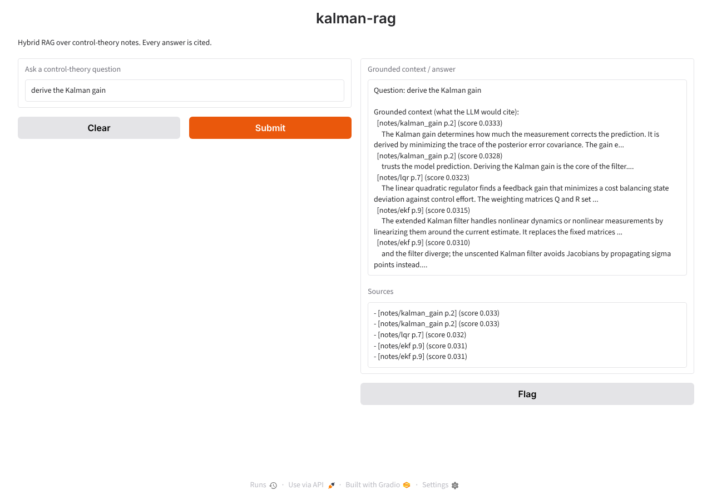

# kalman-rag

**A niche Retrieval-Augmented Generation system that cites its sources** — Project 04 of 12 (ZERO_TO_ANTHROPIC).

RAG makes a language model answer from *your* documents instead of from memory.
kalman-rag does it over control-theory notes: chunk → dense + lexical search →
Reciprocal Rank Fusion → (rerank) → a grounded, cited answer from Claude.

The retrieval core runs fully offline (TF-IDF stands in for neural embeddings). The
production pieces — BGE-M3 embeddings in pgvector, Cohere rerank, Claude answering —
are included as reference code and need your API keys / a database.

[](https://github.com/kashyapphassan2000-netizen/kalman-rag/actions/workflows/ci.yml)

Stack: Python 3.12, scikit-learn, rank_bm25, NumPy, Gradio; production: FlagEmbedding, pgvector, Cohere, Anthropic. Cost: $0 offline.

```
question ──┬─> TF-IDF / BGE-M3 cosine ──┐
           └─> BM25 keyword ranking ────┴─> RRF fusion ─> (Cohere rerank) ─> Claude: cited answer
```

## Quickstart

```bash
pip install -e ".[dev,app]"
pytest -q                                      # 4 tests
PYTHONPATH=.:data python eval/goldset.py       # retrieval eval
python app/app.py                              # Gradio UI on http://127.0.0.1:7860
# production answer step (optional):
pip install -e ".[production]" && export ANTHROPIC_API_KEY=... COHERE_API_KEY=...
```

## Headline results (measured offline)

| metric | result |
|---|---|
| goldset top-1 (10 keyword-style questions) | **9/10 = 90%**, MRR 0.95 |
| paraphrase set top-1 (5 user-style questions) | **1/5 = 20%**, MRR 0.52 ← the case neural embeddings must fix |
| ablation: BM25 alone / TF-IDF alone / hybrid | 10/10 / 9/10 / 9/10: hybrid adds nothing while both sides are word-matchers |
| tests | 4 passed |
| Claude answer step | plumbing verified with fake clients; **not run live** (no keys here) |




---

## Build log — the story, day by day

### Day 0 — setup

```bash
mkdir kalman-rag && cd kalman-rag
python3 -m venv .venv && source .venv/bin/activate
pip install rank_bm25 scikit-learn numpy gradio
mkdir -p kalman_rag data eval tests app docs && touch kalman_rag/__init__.py
git init && git add -A && git commit -m 'chore: scaffold kalman-rag'
```
Production extras, used only with keys: `pip install FlagEmbedding cohere anthropic psycopg2-binary pgvector`.

### Day 1 (Monday) — build the corpus (`data/corpus.py`)

**Goal:** a document collection that is (a) about a domain I know, (b) legally
clean for a public repo, and (c) big enough that retrieval has to work for it.

**The sourcing decision.** The real project would ingest public-domain control
texts and NASA technical reports. Modern textbook PDFs "found online" are not
acceptable in a public repo. For a runnable, copyright-clean demo I wrote **10 original
notes** myself, one topic each, with a `source` label and a page-like id so answers
can cite `[notes/kalman_gain p.2]`:

| page | source | topic |
|---|---|---|
| 1 | notes/kalman_basics | what the Kalman filter is; predict + update |
| 2 | notes/kalman_gain | how the gain is derived and what it trades off |
| 3 | notes/state_space | state transition A, input B, measurement H |
| 4 | notes/noise_covariance | tuning Q and R |
| 5 | notes/observability | observability matrix, rank test |
| 6 | notes/controllability | controllability matrix, duality |
| 7 | notes/lqr | LQR, Riccati equation, LQG duality |
| 8 | notes/pid | P, I, D terms; windup; noise |
| 9 | notes/ekf | extended / unscented Kalman filter |
| 10 | notes/stability | eigenvalue tests, Lyapunov |

601 words total; each note is 51–66 words. I made the topics **deliberately
overlap** (Kalman gain vs. noise covariance vs. LQR all talk about "gain", Q and R;
observability and state-space both mention the measurement and transition matrices)
so that retrieval faces real ambiguity instead of a toy where every query has one
obvious keyword.

**Commit:** `feat: original control-theory corpus (10 notes)`

### Day 2 (Tuesday) — chunking (`kalman_rag/retrieve.py`, part 1)

**Goal:** split documents into pieces small enough to embed and retrieve precisely.

You can't embed a whole textbook as one vector: one vector for 300 pages averages
every topic into mush. The choices:

| strategy | what it does | trade-off |
|---|---|---|
| fixed-size | every N words | simple; can cut mid-idea |
| sentence / semantic | split on meaning boundaries | cleaner; more work |
| overlap (10–20%) | neighbouring chunks share edge text | nothing lost at a cut; some duplication |

**What I wrote:** a `Chunk` dataclass (`text, source, page` — the citation travels
with the text), and `chunk_documents(corpus, max_words=60, overlap=12)`: documents of
≤ 60 words stay whole; longer ones are cut into 60-word windows that advance by
48 words, so consecutive chunks share 12 words (20%). Plus `_tokenize()`, a
lowercase alphanumeric tokenizer for BM25 tomorrow.

```text
10 docs -> 17 chunks
  [notes/kalman_basics p.1] 58 words: The Kalman filter is a recursive estimator for lin...
  [notes/kalman_gain p.2] 60 words: The Kalman gain determines how much the measuremen...
  [notes/kalman_gain p.2] 14 words: trusts the model prediction. Deriving the Kalman g...
  [notes/state_space p.3] 60 words: A discrete-time state-space model writes the next ...
  [notes/state_space p.3] 14 words: Kalman filter's predict step uses A and B, and its...
  ...
  [notes/stability p.10] 51 words: A continuous-time linear system is asymptotically ...
```

**What I noticed:** my notes are 51–66 words, just over the 60-word window, so
each long note produces a **tiny 14–18-word tail chunk that is mostly overlap** (12
of its 14 words are repeated from the previous chunk). That's harmless for retrieval
quality here (the tail still carries the right citation), but it means the same note
can occupy two of the top-5 slots. On a real corpus I'd merge tails shorter than
~half a window into the previous chunk. I kept the guide's settings so the numbers
are comparable, and wrote the issue down instead.

**Commit:** `feat: overlapping word-window chunker`

### Day 3 (Wednesday) — the hybrid retriever: dense + BM25 + RRF

**Goal:** find the right chunk two different ways and merge the two rankings.

**Why two retrievers.** Dense embeddings capture *meaning* (paraphrases match), but
they can blur rare exact terms. BM25 is keyword ranking done right: it rewards a
chunk for containing the query words often (term frequency, saturating via `k1`),
discounts words that appear everywhere (IDF, so "the" barely counts), and normalizes
for length (`b`) so long chunks don't win by size. Each catches what the other misses.

**What I wrote — `HybridRetriever`:**
- **Dense:** `TfidfVectorizer` turns every chunk into a vector; a query is scored by
  cosine similarity, `(a·b) / (|a||b|)`. TF-IDF is a stand-in for BGE-M3: different
  vectors, *identical* mechanics (vectorize → cosine → rank).
- **Lexical:** `BM25Okapi` over the same chunks, tokenized by `_tokenize`. Both
  indexes are built from the **same list in the same order**, because the fusion step
  joins them by index.
- **Reciprocal Rank Fusion:** `score(chunk) = Σ 1 / (60 + rank)` over both rankings
  (rank 0 = best). RRF only looks at ranks, so I never have to make a cosine score and
  a BM25 score comparable. A chunk both retrievers like collects the most votes.
- **`grounded_answer`:** offline stand-in for the LLM step. It prints exactly the
  cited context the model would receive.

```text
Question: derive the Kalman gain

Grounded context (what the LLM would cite):
  [notes/kalman_gain p.2] (score 0.0333)
     The Kalman gain determines how much the measurement corrects the prediction. ...
  [notes/kalman_gain p.2] (score 0.0328)
     trusts the model prediction. Deriving the Kalman gain is the core of the filter....
  [notes/lqr p.7] (score 0.0323)
     The linear quadratic regulator finds a feedback gain that minimizes a cost ...
```

**Checking the math against the scores:** the top chunk was rank 0 in *both* lists,
so its score should be 1/60 + 1/60 = **0.03333** — the code gives 0.03333. The second
score, 0.0328, is the Part-A worked example exactly: 1/(60+0) + 1/(60+2) = 0.03280
(first in one retriever, third in the other). LQR comes third because it also talks
about a "gain": a sensible near-miss.

**Commit:** `feat: hybrid TF-IDF + BM25 retriever with RRF`

### Day 4 (Thursday) — the production dense store: BGE-M3 + pgvector (`kalman_rag/embeddings.py`)

**Goal:** the real dense retriever, with the same role TF-IDF plays offline.

- **`embed_texts`** — BGE-M3 (`BAAI/bge-m3`) turns each chunk into a 1024-number
  vector that encodes *meaning*, so "how much should I trust the sensor?" can land
  near the Kalman-gain note even though they share almost no words. That's what
  TF-IDF can't do.
- **`create_table`** — enables the `vector` extension, creates
  `chunks(source, page, body, embedding vector(1024))`, and adds an **HNSW index**
  (`vector_cosine_ops`). I added the index line; the guide mentions HNSW but its code
  never creates one, and without it pgvector does an exact scan of every row.
- **`upsert_chunks`** — one row per chunk, keeping `source`/`page` for citations.
- **`vector_search`** — `ORDER BY embedding <=> query LIMIT k`; `<=>` is cosine
  **distance**, so `1 − distance` is reported as the similarity score.

**Why HNSW (approximate nearest neighbour):** an exact search compares the query to
every stored vector, which is linear in corpus size. HNSW builds a layered
neighbour graph and searches greedily from a coarse top layer down to fine layers,
touching a small fraction of the vectors for ~99% recall. For my 17 chunks a brute-force
scan is instant; HNSW matters at hundreds of thousands of chunks.

**What I could and couldn't verify here:** BGE-M3 is a multi-GB model download and
pgvector needs a running Postgres, so this file is **reference code, not executed**.
I did verify that it compiles and imports cleanly
(`create_table, embed_texts, upsert_chunks, vector_search`), and re-checked the
Part-A cosine example numerically: `cos(q,a) = 0.949`, `cos(q,b) = 0.949`. Because
`retrieve.py` and this file both do "vectorize → cosine → rank", swapping TF-IDF for
BGE-M3 doesn't touch BM25, RRF, or the eval.

To run it yourself:
```bash
pip install FlagEmbedding psycopg2-binary pgvector
docker run -d -p 5432:5432 -e POSTGRES_PASSWORD=postgres pgvector/pgvector:pg16
```

**Commit:** `feat: production BGE-M3 + pgvector dense store (reference)`

### Day 5 (Friday) — rerank + grounded answer: Cohere + Claude (`kalman_rag/answer.py`)

**Goal:** turn a ranked list of chunks into a short, cited answer that refuses to make things up.

**1. Rerank (`rerank`).** First-stage retrieval uses *bi-encoders*: the query and each
chunk are vectorized separately, so search is fast but approximate. A
**cross-encoder** reranker (Cohere `rerank-english-v3.0`) reads the query and a chunk
*together* and scores them jointly. It's more accurate and too slow for the whole
corpus, so the pattern is: retrieve ~20 cheaply, rerank down to 5. I use Cohere SDK
v7's `ClientV2.rerank(model, query, documents, top_n)` — I checked the installed
SDK's signature instead of guessing it.

**2. Grounded prompt (`GROUNDED_PROMPT`, `build_prompt`).** Every chunk goes into the
prompt prefixed with its citation, `[notes/kalman_gain p.2] …`, and the instructions
are: answer using **only** this context, cite every claim as `[source p.N]`, and say
so if the context doesn't contain the answer.

**3. Answer (`answer`).** One `messages.create` call to **Claude Haiku 4.5**
(`claude-haiku-4-5`), the cheap, fast model the guide picks for this step. Two small
changes from the guide's version: `max_tokens` 1024 instead of 600 (so a cited
derivation isn't cut off mid-sentence), and the code checks `stop_reason` and joins
only `text` blocks instead of assuming `content[0]` is text. `to_candidates()` adapts
the retriever's `(Chunk, score)` tuples to the dicts this module uses.

**How I verified it without API keys:** there are no Cohere/Anthropic credentials in
this environment, so both functions accept an injected `client`. I ran the full path
(real retriever → reranker → answer) with fake clients that record what they receive:
```text
reranked: [('notes/kalman_gain', 2), ('notes/kalman_gain', 2), ('notes/lqr', 7)]
answer: The gain is ... [notes/kalman_gain p.2]
model: claude-haiku-4-5 | max_tokens: 1024
--- prompt sent ---
You are a control-theory tutor. Answer the question using ONLY the context below. Cite every
claim as [source p.N]. If the context does not contain the answer, say so -- never invent facts.

Context:
[notes/kalman_gain p.2] trusts the model prediction. Deriving the Kalman gain is the core of the filter.

[notes/kalman_gain p.2] The Kalman gain determines how much the measurement corrects ...
```
That proves the plumbing: all 17 candidates reach the reranker, its order is
respected, and the prompt carries every citation. It does **not** prove answer
quality; that needs a live run with keys:
```bash
export ANTHROPIC_API_KEY=...  COHERE_API_KEY=...
```

**Commit:** `feat: Cohere rerank + grounded, cited Claude answer (reference)`

### Day 6 (Saturday) — the goldset eval + tests

**Goal:** a number that tells me whether retrieval works, decided *before* I look at results.

**`eval/goldset.py`:** 10 questions, each paired with the note that should answer
it. I wrote the questions and gold labels first and did not edit them after seeing
the output. For each question it prints whether the gold note is ranked #1, the gold
note's rank, top-1 accuracy and **MRR** (mean reciprocal rank: 1 for rank 1, ½ for
rank 2, …). I also added a second set of 5 **paraphrases**: questions phrased the way
a user talks, sharing few words with the notes.

```text
$ PYTHONPATH=.:data python eval/goldset.py

goldset (keyword-style questions)
  OK   derive the Kalman gain                               -> notes/kalman_gain        (gold rank 1)
  MISS two steps predict and update                         -> notes/state_space        (gold rank 2)
  OK   state transition and measurement matrix              -> notes/state_space        (gold rank 1)
  OK   reconstruct internal state from outputs              -> notes/observability      (gold rank 1)
  OK   how to tune process noise and measurement noise      -> notes/noise_covariance   (gold rank 1)
  OK   drive the system to any state with an input          -> notes/controllability    (gold rank 1)
  OK   Riccati equation optimal feedback                    -> notes/lqr                (gold rank 1)
  OK   integral windup and derivative noise                 -> notes/pid                (gold rank 1)
  OK   nonlinear measurements Jacobian linearization        -> notes/ekf                (gold rank 1)
  OK   eigenvalues inside the unit circle                   -> notes/stability          (gold rank 1)
top-1 accuracy: 9/10 = 90%   MRR: 0.950

paraphrase set (few shared words; hard for TF-IDF/BM25)
  MISS how much should I trust the sensor versus the model? -> notes/noise_covariance   (gold rank 2)
  OK   my estimate is too jumpy, what knob makes it smoothe -> notes/noise_covariance   (gold rank 1)
  MISS can I figure out hidden variables just by watching t -> notes/ekf                (gold rank 4)
  MISS my controller keeps overshooting the target          -> notes/lqr                (gold rank 2)
  MISS will this system blow up or settle down?             -> notes/ekf                (gold rank 3)
top-1 accuracy: 1/5 = 20%   MRR: 0.517
```

**Reading the results honestly:**
1. **90% top-1 on the goldset.** The one miss is a real ambiguity, not noise: the
   state-space note ends with "the predict step uses A and B, and its update step uses
   H", so it legitimately matches "predict and update". The right note is still #2,
   and a reranker plus a 5-chunk context would hand both to the LLM.
2. **Hybrid did *not* beat BM25 here.** I ran each retriever alone:
   ```text
   dense (TF-IDF) only    goldset 9/10   paraphrases 1/5
   lexical (BM25) only    goldset 10/10  paraphrases 1/5
   hybrid RRF             goldset 9/10   paraphrases 1/5
   ```
   That contradicts the "hybrid beats either alone" claim, and the reason matters:
   **TF-IDF is a word-matcher too**, so fusing it with BM25 adds no new kind of
   signal. Hybrid pays off when the dense side is a *neural* embedding (BGE-M3) that
   understands meaning. Offline, BM25 alone would be the better choice.
3. **Paraphrases: 20%.** The gold note is usually in the top 2–4 (MRR 0.52), but
   "how much should I trust the sensor?" doesn't share words with "the Kalman gain
   … trusts the measurement", so word-matching misses it. This set is the benchmark
   to re-run once BGE-M3 is swapped in.

**`tests/test_retrieve.py` (4 tests):** chunk windows overlap by exactly 12 words and
keep their citation; every RRF score equals `1/(60+rank_dense) + 1/(60+rank_bm25)`
computed independently; the Kalman-gain question returns `notes/kalman_gain p.2`; and
the grounded prompt carries citations plus the "ONLY the context" rule, with a fake
Claude client round-tripping the answer.
```text
$ pytest -q
....                                                                     [100%]
4 passed in 1.31s
```
I also added `pyproject.toml` (core deps: numpy, scikit-learn, rank_bm25; extras:
`dev`, `app`, `production`; pytest `pythonpath = [".", "data"]`).

**Commit:** `feat: goldset eval (90% top-1) + paraphrase set + tests`

### Day 7 (Sunday) — the Gradio UI, running for real

**`app/app.py`:** a `gr.Interface` with one textbox in and two out ("Grounded context /
answer" and "Sources"). It builds the retriever once at startup, and `ask()`
retrieves the top 5 chunks. One change from the guide: its docstring says "with API keys
set it shows Claude's grounded answer", but its code never calls Claude. Mine does:
if `ANTHROPIC_API_KEY` is set, `ask()` sends the retrieved chunks through
`kalman_rag.answer.answer`; otherwise it shows the cited context.

**Run it:**
```text
$ python app/app.py
* Running on local URL:  http://127.0.0.1:7860
$ curl -s -o /dev/null -w "HTTP %{http_code}" http://127.0.0.1:7860/
HTTP 200
```
I then drove the page with headless Chromium (Playwright): opened it, clicked
**Submit** with the default question "derive the Kalman gain", waited for the result,
and saved the screenshot at the top of this README. Sources returned:
```text
- [notes/kalman_gain p.2] (score 0.033)
- [notes/kalman_gain p.2] (score 0.033)
- [notes/lqr p.7] (score 0.032)
- [notes/ekf p.9] (score 0.031)
- [notes/ekf p.9] (score 0.031)
```
Note the duplicate `kalman_gain` and `ekf` rows: that's the short-tail-chunk issue
I flagged on Tuesday, now visible to a user. Merging small tail chunks is the first fix.

**CI — `.github/workflows/ci.yml`:** installs the package, runs the 4 tests and the goldset eval.

**Deploy to a free Hugging Face Space** (needs your HF account/token, so not done here):
```bash
huggingface-cli upload <you>/kalman-rag . --repo-type=space
```

**Commit:** `feat: Gradio UI (verified in a browser) + CI`

---

## Production vs the offline build

| stage | offline (verified here) | production (your machine) |
|---|---|---|
| dense vectors | TF-IDF (scikit-learn) | BGE-M3 1024-dim embeddings |
| vector store | in-memory sparse matrix | pgvector in Postgres, HNSW index |
| rerank | skipped (RRF order used) | Cohere cross-encoder, top-20 → top-5 |
| answer | show cited context | Claude Haiku 4.5, grounded + cited |
| chunking, BM25, RRF, eval | identical | identical |

## Done check — Week 4

- [x] pytest green (4 passed); goldset eval prints 90% top-1
- [x] the Gradio app runs and shows cited sources for every query (screenshot above)
- [ ] with keys: Claude returns grounded, cited answers; zero unsourced claims (needs your keys)
- [x] README states the legal sourcing and the honest eval numbers, including the ablation and the paraphrase gap

## Exercises to deepen it

- Swap TF-IDF for BGE-M3 and re-run the **paraphrase set**; that's where the gain should show.
- Merge tail chunks shorter than half a window into the previous chunk; re-run the eval.
- Add a "no answer in context" test: ask an off-topic question live and confirm Claude declines.
- Add a second corpus (PID tuning notes) and watch RRF combine evidence across both.

## If something breaks

- **Retrieval returns irrelevant chunks** — check chunk size, and that BM25 and TF-IDF are built over the *same* chunk list in the same order (RRF fuses by index).
- **pgvector: operator `<=>` does not exist** — run `CREATE EXTENSION IF NOT EXISTS vector;`.
- **Claude answer includes facts not in the context** — strengthen "use ONLY the context" and the "say you don't know" rule.
- **BGE-M3 download fails** — needs internet on first run; the TF-IDF path needs no downloads.

## What I can now answer in an interview

- The RAG pipeline end to end, and why each stage exists.
- Dense vs sparse retrieval, and when hybrid + RRF helps (and when it doesn't: I measured it adding nothing with two lexical retrievers).
- Why a cross-encoder reranker is more accurate but only used on a shortlist.
- How grounded prompting + citations suppress hallucination.
- How to evaluate RAG honestly: labels fixed before results, MRR, ablations, a paraphrase set.
