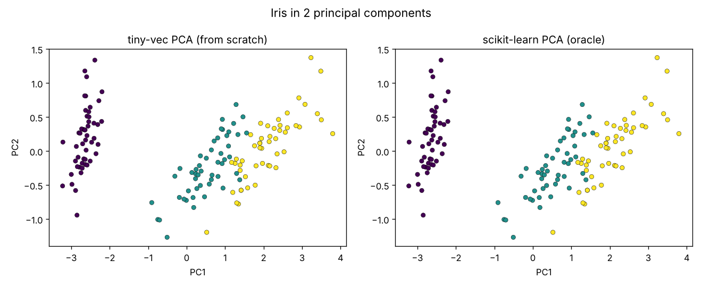

# tiny-vec

**Linear algebra & autograd from first principles** — Project 01 of 12 (ZERO_TO_ANTHROPIC).

A `Vector`, a `Matrix` with naive and Strassen matmul, a reverse-mode autograd
engine that trains an MLP on XOR, and SVD-by-power-iteration + PCA — all in pure
Python. NumPy appears **only in the tests**, as the oracle I check my math against.

[](https://github.com/kashyapphassan2000-netizen/tiny-vec/actions/workflows/ci.yml)

Stack: Python 3.10+, NumPy (tests only), pytest, hypothesis, GitHub Actions. Cost: $0.

## Quickstart

```bash
pip install -e ".[dev]"
pytest --cov=tiny_vec                                    # 11 tests, 80% coverage
python examples/train_xor.py                             # autograd learns XOR
python examples/pca_iris.py                              # PCA plot -> docs/iris_pca.png
python bench/matmul.py --sizes 128,256,512 --leaf 32     # naive vs Strassen
python -c 'from tiny_vec import Value; v=Value(2); (v*v).backward(); print(v.grad)'  # 4.0
```

## Headline results (measured, not copied)

| what | result |
|---|---|
| naive matmul vs NumPy, n=128 | NumPy **~700x faster** (0.10 s vs 0.00014 s) |
| Strassen vs naive | within noise at n=128; Strassen wins from **n≈256**; **1.65x** faster at n=512 |
| XOR, MLP(2,[8,8,1]), SGD lr=0.05 | loss 0.897 → **0.000004** by epoch 200 |
| my PCA vs scikit-learn on iris | max abs difference **3.3e-10** (PC1), **5.0e-08** (PC2) |
| tests / coverage | **11 passed**, **80%** line coverage |


---

## Build log — the story, day by day

Each day below is one commit. I describe what I built, why, the exact commands,
the real output I got, and what surprised me.

### Day 0 — set up the project

**Goal:** an empty, versioned skeleton so every later day is just "add a file, test it, commit".

1. Checked the interpreter: `python --version` → `Python 3.12.3` (anything ≥ 3.10 works).
2. Made a virtualenv and installed the dev tools:
   ```bash
   python3 -m venv .venv && source .venv/bin/activate
   pip install numpy pytest hypothesis pytest-cov scikit-learn matplotlib
   ```
3. Created the folder layout and the first commit:
   ```bash
   mkdir -p tiny_vec tests examples bench docs .github/workflows
   touch tiny_vec/__init__.py
   git init && git add -A && git commit -m 'chore: scaffold tiny-vec'
   ```

**Why this layout:** `tiny_vec/` is the library, `tests/` proves it, `examples/`
shows it working on real problems, `bench/` measures it, `docs/` holds plots.
Keeping those apart is what makes the repo readable to a reviewer in 30 seconds.

### Day 1 (Monday) — the `Vector` class

**Goal:** own the dot product. Every later operation (matmul, norms, neurons) is built from it.

**What I wrote — `tiny_vec/vector.py`:**
- A `Vector` with `__slots__ = ("data",)` holding a plain `List[float]`. `__slots__`
  stops Python creating a per-instance `__dict__`, which saves memory and makes typos
  like `v.dta = …` an error instead of a silent new attribute.
- Dunder plumbing (`__len__`, `__iter__`, `__getitem__`, `__repr__`, `__eq__`) so a
  Vector behaves like a native sequence.
- `_check()` raises `ValueError("dim mismatch: …")` — fail loudly rather than let `zip`
  silently truncate the longer vector (a classic bug).
- Algebra: `+`, `-`, scalar `*` (and `__rmul__` so `2 * v` works), unary `-`.
- `dot()` = `sum(a*b for a, b in zip(...))`.
- `norm(p)` handles L2 (via `sqrt(v·v)`), L1, and general Lp.
- `normalize()` refuses the zero vector with a `ZeroDivisionError` instead of returning NaNs.

**How I tested it — `tests/test_core.py`:**
- Three example tests that compare against NumPy: `dot` vs `np.dot`, `norm` vs
  `np.linalg.norm` (using `math.isclose`, never `==`, for floats), and add/sub.
- One **property-based** test with `hypothesis`: it generates hundreds of random float
  lists and asserts `a·b == b·a`. Example tests check cases I thought of; property tests
  check cases I didn't.

```text
$ pytest tests/test_core.py -q
....                                                                     [100%]
4 passed in 0.50s
```

**Commit:** `feat: Vector with dot/norm + property tests`

### Day 2 (Tuesday) — the `Matrix` class + naive matmul

**Goal:** an honest, slow baseline. You cannot claim a speedup tomorrow without a
correct slow version today.

**What I wrote — `tiny_vec/matrix.py`:**
- `Matrix` stores `List[List[float]]` plus `rows`/`cols`, and rejects ragged input
  (`ValueError("ragged matrix…")`) in the constructor so a bad shape never gets far.
- Constructors `identity(n)` and `zeros(r, c)`; plumbing (`__getitem__`, `__eq__`,
  `__repr__`, `to_list`), `transpose()` and the `.T` property, elementwise `+`/`-`.
- **Naive matmul**: the triple loop. One real trick: I transpose `other` once
  (`bt = other.transpose().data`) so the inner loop zips *row with row* instead of
  striding down a column — fewer index lookups, same O(n³). Hooked up to `@` via
  `__matmul__ = matmul`.
- The same file already contains the Strassen code (`strassen`, `_pad`, `_add`,
  `_sub`, `_naive`, `_strassen`); I study and benchmark it on Day 3.

**Benchmark vs NumPy (n = 128):**
```text
# first run, NumPy cold (includes BLAS warm-up):
tiny-vec 0.099s  numpy 0.00043s  -> numpy 231x faster
# after a NumPy warm-up call, three runs:
tiny-vec 0.097s  numpy 0.00014s  -> numpy 707x faster
tiny-vec 0.106s  numpy 0.00014s  -> numpy 751x faster
tiny-vec 0.103s  numpy 0.00014s  -> numpy 746x faster
```
Lesson #1 of benchmarking: the first call is not representative — warm up, then
repeat. **NumPy is ~700x faster** on this machine. Why: it calls an optimized BLAS
written in C/assembly (SIMD, cache blocking, multithreading) over contiguous memory,
while my loop pays Python interpreter overhead on every single multiply-add
(boxing floats, dispatching `*` and `+`, iterating lists of pointers).

**Tests added:** matmul vs `np.array(A) @ np.array(B)` with `np.allclose`, transpose
vs `.T`, identity vs `np.eye`.
```text
$ pytest tests/test_core.py -q
.......                                                                  [100%]
7 passed in 0.45s
```

**Commit:** `feat: Matrix + naive matmul, benchmarked vs NumPy`

### Day 3 (Wednesday) — Strassen + an honest benchmark

**Goal:** test a textbook claim against reality. Strassen does **7** recursive
half-size multiplies instead of 8, so its complexity drops from O(n³) to
O(n^log₂7) ≈ O(n^2.807). The textbook says it should win early. Does it, in Python?

**How Strassen works (re-reading the Day-2 code):**
1. `strassen()` pads both matrices with zeros up to the next power of two (`_pad`),
   because the algorithm splits in halves recursively.
2. `_strassen()` splits A and B into four quadrants each (`a11…a22`, `b11…b22`).
3. It forms the seven products `m1…m7` (each one a recursive call on sums/differences
   of quadrants) and rebuilds the four output quadrants from them:
   `c11 = m1 + m4 − m5 + m7`, `c12 = m3 + m5`, `c21 = m2 + m4`, `c22 = m1 − m2 + m3 + m6`.
4. Below `leaf` size it stops recursing and falls back to `_naive` — recursion on tiny
   blocks costs more in additions and list slicing than it saves in multiplies.
5. Finally it crops the padding off.

**What I wrote — `bench/matmul.py`:** a CLI (`--sizes`, `--algo`, `--leaf`) that times
`A.matmul(B)` vs `A.strassen(B, leaf=…)` on random matrices with `time.perf_counter()`
and prints a table with the winner.

**Real results on this machine** (`python bench/matmul.py --sizes 128,256,512 --leaf 32`):
```text
     n |    naive (s) |   strassen (s) | winner
----------------------------------------------------
   128 |       0.1528 |         0.1071 | strassen
   256 |       0.8114 |         0.8384 | naive
   512 |       9.2600 |         5.5680 | strassen
```
That first table contradicts itself (Strassen wins at 128, loses at 256), so I did
not trust a single run. I repeated n = 128/256 three more times:
```text
   128 |       0.0934 |         0.1099 | naive
   256 |       0.8378 |         0.7689 | strassen
   128 |       0.0972 |         0.1096 | naive
   256 |       0.8244 |         0.7791 | strassen
   128 |       0.1364 |         0.1106 | strassen     <- naive had a noisy spike
   256 |       0.8361 |         0.7702 | strassen
```
and once with `--leaf 64`:
```text
   128 |       0.0998 |         0.1078 | naive
   256 |       0.8960 |         0.8348 | strassen
   512 |       9.3361 |         5.6670 | strassen
```

**Honest conclusion:** at n = 128 the two are within noise and naive usually wins;
**Strassen reliably wins from n ≈ 256**, and at n = 512 it is **~1.65x faster**
(5.6 s vs 9.3 s). The crossover sits higher than the textbook's estimate because in
pure Python every one of Strassen's extra matrix additions and list slices runs
through the interpreter, inflating the constant factor that the asymptotic
argument ignores. And all of this is still ~700x slower than NumPy — algorithmic
cleverness does not beat a C/BLAS implementation of the dumb algorithm.

**Cross-check test:** `test_strassen_matches_naive` multiplies two random 130×130
matrices (deliberately *not* a power of two, to exercise padding) and asserts the
result matches NumPy with `np.allclose(..., atol=1e-6)` — not `==`, because Strassen
reorders floating-point additions and float addition is not associative.
```text
$ pytest -q
........                                                                 [100%]
8 passed
```

**Commit:** `feat: Strassen matmul + honest crossover benchmark`

### Day 4 (Thursday) — reverse-mode autograd + an MLP that learns XOR

**Goal:** the heart of the week. After this, PyTorch's `loss.backward()` stops being magic.

**What I wrote — `tiny_vec/engine.py` (`Value`):**
- Each `Value` stores `data`, `grad`, the set of parent nodes `_prev`, the op name
  `_op`, and a `_backward` closure. When an op creates an output node it also
  defines *how to push gradient from that output back into its inputs*.
- The key line, in `__mul__`: `self.grad += other.data * out.grad`. That **is** the
  chain rule — "gradient arriving at me × my local derivative (d(a·b)/da = b)".
- Why `+=` and not `=`: a value used twice in a graph (e.g. `a` in `a*b + a**2`) must
  **sum** the gradient from both paths. With `=` the second path would overwrite the first.
- Ops: `+`, `*`, `**` (constant power), `relu`, `tanh` (local derivative `1 − t²`),
  `exp`; plus sugar (`-x`, `x - y`, `1 - x`, `2 * x`, `/`) built from those primitives
  so they automatically get correct gradients.
- `backward()`: a depth-first **topological sort** (every node appears after all of
  its inputs), set the output's grad to 1.0, then call each node's `_backward` in
  reverse order — so a node is only processed once every consumer has deposited
  its gradient into it.

**What I wrote — `tiny_vec/nn.py`:** `Module` (with `parameters()` and `zero_grad()`),
`Neuron` (weights ~ U(−1, 1), bias 0, `tanh(w·x + b)`), `Layer` (a list of neurons),
`MLP` (stacked layers; the **last layer is linear**, all others use tanh).

**What I wrote — `examples/train_xor.py`:** an `MLP(2, [8, 8, 1])` (105 parameters)
trained with plain SGD, lr = 0.05, on mean-squared error over the 4 XOR points.
XOR is the smallest problem that is *not linearly separable*, so it can only be
solved if the hidden layer and backprop actually work.

```text
$ PYTHONPATH=. python examples/train_xor.py
params: 105
epoch    0  loss 0.897416
epoch  200  loss 0.000004
epoch  400  loss 0.000000
...
FINAL loss 0.000000
  [0.0, 0.0] -> +0.000  (target 0.0)
  [0.0, 1.0] -> +1.000  (target 1.0)
  [1.0, 0.0] -> +1.000  (target 1.0)
  [1.0, 1.0] -> +0.000  (target 0.0)

PASS: loss < 0.01
real	0m7.895s
```
The net solved XOR within 200 epochs. The whole run takes ~8 s for just 105
parameters — a preview of why Week 3 moves from scalar `Value`s to NumPy tensors.

**Gradient test — `tests/test_math.py`:** for `f(a, b) = (a·b + a²)·relu(b)` at
a = −1.5, b = 2, I compare the analytic `a.grad` against a **central finite
difference** `(f(a+h) − f(a−h)) / 2h` with h = 1e-6. They agree to 1e-4, so the
engine's chain rule is right (and `a` is used twice, so this also tests `+=`).
```text
$ pytest -q
.........                                                                [100%]
9 passed in 1.25s
```

**Commit:** `feat: reverse-mode autograd engine + MLP learns XOR`

### Day 5 (Friday) — SVD by power iteration + PCA on iris

**Goal:** singular value decomposition without calling a library SVD, then PCA on top of it.

**The idea:** the right singular vectors of A are the eigenvectors of the Gram matrix
AᵀA, and its eigenvalues are the *squared* singular values. So:
1. **Power iteration** (`power_iteration`): start from a random unit vector `b`, repeat
   `b ← normalize(M·b)`. Each multiply amplifies the component along the dominant
   eigenvector more than the others, so `b` converges to it. The eigenvalue is the
   Rayleigh quotient `bᵀMb`; I stop when it changes by less than 1e-12.
2. **Deflation** (inside `svd`): after finding (λ, v), subtract it out —
   `G ← G − λ·v·vᵀ` — so the *next* power iteration finds the next-largest component.
3. **σ = √λ**, and the left singular vectors come from `u = A·v / σ` (guarding σ ≈ 0).
4. **PCA** (`pca`): centre each column (subtract the mean), run `svd` on the centred
   data, and the scores are `U·S` (equivalently `X_c·V`).

**What I wrote:** `tiny_vec/linalg.py` (`_matvec`, `_transpose`, `_gram`,
`_normalize`, `power_iteration`, `svd`, `pca`) and `examples/pca_iris.py`, which
projects the 150×4 iris data to 2-D with my PCA and with scikit-learn's PCA side by
side, and saves the plot.

```text
$ PYTHONPATH=. python examples/pca_iris.py
wrote docs/iris_pca.png
PC1 captures 94.6% of the top-2 variance
```



The two panels are identical. I didn't trust my eyes, so I also measured it: after
aligning signs (an eigenvector's sign is arbitrary, so a flipped axis would be fine),
the largest difference between my scores and scikit-learn's is **3.3e-10 on PC1** and
**5.0e-08 on PC2**. Cross-check: sklearn's explained-variance ratio is
[0.9246, 0.0531] → 0.9246 / (0.9246 + 0.0531) = 94.6%, the same number my script printed.

**Tests added (`tests/test_math.py`):**
- power iteration on `diag(2, 1)` returns λ = 2;
- my singular values of a random 5×3 matrix match `np.linalg.svd` to 1e-4.
```text
$ pytest -q
...........                                                              [100%]
11 passed in 1.15s
```

**Commit:** `feat: SVD via power iteration + PCA on iris with plot`

### Day 6 (Saturday) — package it: public API, pyproject, CI, coverage

**Goal:** turn a folder of scripts into a real, installable, tested package.

1. **Public API — `tiny_vec/__init__.py`:** re-exports `Vector, Matrix, Value, Neuron,
   Layer, MLP, power_iteration, svd, pca`, sets `__version__ = "0.1.0"` and `__all__`.
   This is what makes `from tiny_vec import Value` work for a user.
2. **`pyproject.toml`:** zero runtime dependencies (the library is pure Python); NumPy,
   pytest, hypothesis, scikit-learn and matplotlib live in the `dev` extra. Built with
   `hatchling`. `[tool.pytest.ini_options] pythonpath = ["."]` lets tests import the
   package from the repo root without installing it.
3. **CI — `.github/workflows/ci.yml`:** on every push to `main` and every PR, GitHub
   Actions installs `.[dev]` and runs the tests with coverage on Python **3.10, 3.11
   and 3.12**.
4. **Coverage run:**
```text
$ pytest --cov=tiny_vec --cov-report=term-missing
Name                   Stmts   Miss  Cover   Missing
----------------------------------------------------
tiny_vec/__init__.py       7      0   100%
tiny_vec/engine.py        83     20    76%   24, 65-71, 74-80, 101, 104, 107, 110, 113, 116, 119
tiny_vec/linalg.py        59      6    90%   87-93
tiny_vec/matrix.py        98      9    91%   23, 32, 36, 39, 42, 56, 60, 66, 77
tiny_vec/nn.py            38     19    50%   15, 18-19, 24-26, 29-30, 33, 38, 41-42, 45, 50-51, 57-59, 62
tiny_vec/vector.py        48     14    71%   25, 28, 31, 38, 51, 56, 65-67, 70-73, 76
----------------------------------------------------
TOTAL                    333     68    80%
11 passed in 8.15s
```
**Honest read of that table:** 80% overall hits the target, but `nn.py` is only 50%
because the MLP is exercised by `examples/train_xor.py`, not by a unit test, and
`tanh`/`exp`/division in `engine.py` are not gradient-checked yet. Those are the
first tests I'd add next.

**Commit:** `docs: README + CI + coverage at 80%`

### Day 7 (Sunday) — build, install-check, publish, write it up

**Goal:** prove a stranger can install this, and write the post that goes in applications.

1. **Build the distributions:**
```text
$ pip install build twine && python -m build
Successfully built tiny_vec-0.1.0.tar.gz and tiny_vec-0.1.0-py3-none-any.whl
```
2. **Verify it installs in a fresh environment** (a brand-new venv, run from `/tmp`
   so the repo's source folder can't be imported by accident):
```text
$ python -m venv /tmp/fresh && /tmp/fresh/bin/pip install dist/tiny_vec-0.1.0-py3-none-any.whl
$ /tmp/fresh/bin/python -c 'from tiny_vec import Value; v=Value(2); (v*v).backward(); print(v.grad)'
4.0
```
   4.0 is d(v²)/dv at v = 2 — the package works outside the repo.
3. **Upload to TestPyPI** (the practice index). This needs *your* TestPyPI account and
   API token, so it is the one step not executed here:
```bash
twine upload --repository testpypi dist/*
pip install -i https://test.pypi.org/simple/ tiny-vec
```
4. **Blog post:** [`docs/blog.md`](docs/blog.md) — "I built tiny NumPy and learned why
   NumPy is fast" (~330 words): what I built, the 700x speed gap and why, and the
   Strassen-crossover surprise.

**Commit:** `docs: blog post + release build verified`

---

## Done check — Week 1

- [x] 7 day-by-day commits (scaffold → Vector → Matrix → Strassen → autograd → SVD/PCA → packaging)
- [x] `pytest` green: 11 passed; coverage 80%
- [x] wheel builds and installs cleanly in a fresh venv
- [x] README has the benchmark tables and the CI badge
- [ ] TestPyPI upload (needs your token — command above)

## If something breaks

- **`ModuleNotFoundError: No module named 'tiny_vec'`** — run from the repo root (pytest's
  `pythonpath = ["."]` handles tests); for scripts use `PYTHONPATH=. python examples/…` or `pip install -e .`.
- **Strassen slightly off from NumPy** — compare with `np.allclose(..., atol=1e-6)`, never `==`.
- **XOR loss stuck at 0.25** — the net is predicting 0.5 everywhere: lower lr, keep the hidden layer, seed the RNG.
- **Power iteration gives the wrong vector** — it only finds the dominant one; later components need deflation.

## What I can now answer in an interview

- Implement dot product / matmul / transpose from memory.
- Why NumPy is ~700x faster than pure Python — measured, not memorized.
- Strassen's 7-multiply trick and why the real crossover is later than the textbook's.
- Reverse-mode autodiff: graph, topological sort, chain rule, gradient accumulation.
- SVD via power iteration + deflation; PCA as the directions of maximum variance.
